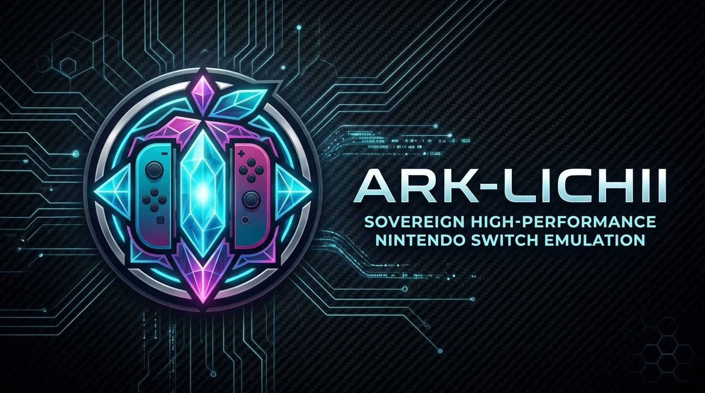
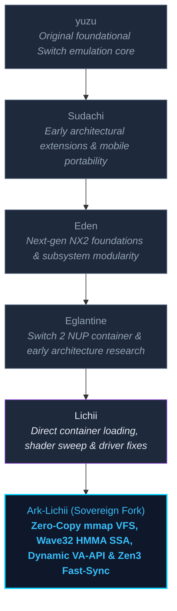

<!--
# SPDX-FileCopyrightText: Copyright 2026 Arkheion Project & Ark-Lichii Contributors
# SPDX-FileCopyrightText: Copyright 2025 Eden Emulator Project
# SPDX-FileCopyrightText: 2018 yuzu Emulator Project
# SPDX-License-Identifier: GPL-3.0-or-later
-->

<p align="center">
  
</p>

<p align="center">
  <strong>Sovereign High-Performance Nintendo Switch & Switch 2 Emulator</strong>
</p>

<p align="center">
  <a href="https://github.com/Ooriginador/Ark-lichii/releases"></a>
  <a href="https://github.com/Ooriginador/Ark-lichii/actions"></a>
  <a href="#architectural-lineage"></a>
  <a href="LICENSE.txt"></a>
</p>

---

## Overview

**Ark-Lichii** is an experimental, sovereign high-performance Nintendo Switch and Switch 2 emulator engineered in C++. It builds upon the collective engineering lineage of **Lichii**, **Eglantine**, **Eden**, **Sudachi**, and **yuzu**, introducing next-generation low-latency compute subsystems, zero-copy memory-mapped container virtualization, RDNA2 Wave32 compute optimizations, and adaptive hardware acceleration.

This is an independent fork and research project developed by the Arkheion community and open-source contributors. Ark-Lichii is not affiliated with Nintendo.

---

## Architectural Lineage & Heritage

Ark-Lichii honors and preserves every layer of technical heritage from which it descends, extending the stack with sovereign compute runtime patterns:



---

## Sovereign Innovations & Core Enhancements

### 1. Zero-Copy Direct Memory-Mapped VFS (`mmap` + THP)
- **Elimination of Disk Read Bottlenecks**: Implemented zero-copy streaming for guest filesystem access via POSIX `mmap` (`MAP_SHARED`), transparent huge pages (`MADV_HUGEPAGE`, 2MB pages), and kernel sequential readahead.
- **Direct Pointers**: Filesystem reads bypass user-space staging buffers when contiguous blocks are accessed directly, yielding instant ROMFS mount times and stutter-free open-world streaming.

### 2. RDNA2 Wave32 Compute & Fast Software HMMA
- **Wave32 Subgroup Specialization**: Strictly bound guest warp sizes to Wave32 hardware stages (eliminating 64-lane ballot bloating on AMD RDNA2 / RADV architectures).
- **Unrolled Fast Software HMMA**: Added accelerated software tensor matrix multiplication with IEEE-754 hardware FP16 rounding (`OpFConvert`) and aggressive inline SSA evaluation for non-accelerated SPIR-V paths.
- **Descriptor & Buffer Decoupling**: Decoupled buffer garbage collection from device-wide texture cache memory, preventing spurious GPU buffer downloads and eliminated RADV ACO scalar cache desync.

### 3. Adaptive NUP Container Streaming Engine
- **Dynamically Scaled ZSTD Decompression Cache**: Auto-scales the NUP decompression cache up to 4 GiB (`EDEN_NX2_NUP_CACHE_MB`) for massive open-world Switch 2 packages (>16 GiB), backed by 64 MiB TOC `madvise` prefetching to completely prevent `/tmp` spill stall degradation.
- **Shadow Merged VFS**: Unified Base Game + Update patch hierarchy without duplicating file descriptors or resident memory allocations.

### 4. Dynamic Multi-GPU VA-API & AVX2 Video Decoding
- **Dynamic DRM Device Discovery**: Replaced hardcoded `/dev/dri` nodes with runtime scanning across `/dev/dri/renderD128-136`, fully supporting discrete/hybrid GPU configurations (e.g. `DRI_PRIME=1`, AMD RX 6600M + Cezanne APU).
- **Environment Overrides**: First-class support for `VAAPI_DEVICE` and `DRI_DEVICE` overrides.
- **Universal EOS Drain & Cutscene Pacing**: Low-delay video synchronization point tracking preventing frame-skips and audio/video desync during complex FMVs.

### 5. Spin-Pause Low-Latency Synchronization
- **Fence Fast-Path**: Non-preemptive Zen 3 spin-wait scheduling combined with CPU pause intrinsics on fence waits, minimizing context switches and stabilizing frame times under high load.
- **Zero-Alloc Audio Pipeline**: Memory-pooled SDL3 audio sink callbacks eliminating heap jitter during real-time playback.

### 6. Title-Specific Rendering Enhancements (e.g. *The Legend of Zelda: Ocarina of Time*)
- Automatic 16x Anisotropic Filtering enforcement.
- Barrier feedback loops enabled and reactive flushing configured to resolve multi-layer terrain splatting and transparency artifacts.

---

## Downloads & Setup

Official builds and pre-compiled packages are published on the [Ark-Lichii Releases](https://github.com/Ooriginador/Ark-lichii/releases) page.

### Quick Start (Linux)

```bash
# Clone the Ark-Lichii repository
git clone --recurse-submodules https://github.com/Ooriginador/Ark-lichii.git
cd Ark-lichii

# Run high-performance native launcher with RDNA2 Wave32 & mimalloc optimizations
./bin/lichii-optimized
```

### High-Performance Environment Overrides

Ark-Lichii honors high-performance flags for fine-tuning your hardware:

```bash
# Force custom decompression memory cache (in MiB)
export EDEN_NX2_NUP_CACHE_MB=4096

# Force custom VA-API DRM node for video decoding
export VAAPI_DEVICE=/dev/dri/renderD128

# Force AMD RADV Wave32 compute and SAM
export RADV_PERFTEST="cswave32,sam,nggc"
```

---

## Diagnostics & Tools

Ark-Lichii includes specialized diagnostics for Switch 2 containers and shader analysis under `tools/nx2/`:

- **NUP Container Inspector**:
  ```bash
  python3 tools/nx2/nup_inspector.py "/path/to/game.nup"
  ```
  Validates cryptographic TOC SHA-256 integrity, inspects package layouts, RomFS/ExeFS trees, and outputs optimal memory cache recommendations.

---

## Building from Source

### Dependencies
- C++20 compliant compiler (GCC 12+, Clang 16+, or MSVC 2022+)
- CMake 3.22+
- Ninja build system
- Vulkan SDK 1.3+
- Qt 6 (for GUI build)
- SDL3, FFmpeg, Boost, mimalloc

### Build Commands

```bash
# Configure build
cmake -B build -G Ninja \
  -DCMAKE_BUILD_TYPE=Release \
  -DYUZU_USE_BUNDLED_FFMPEG=ON \
  -DYUZU_TESTS=ON

# Compile the native GUI application
ninja -C build yuzu

# Compile headless CLI and run unit test suite
ninja -C build eden-cli tests
./build/bin/tests
```

---

## Contributing & Community

Contributions are welcome! Please consult the [Contributing Guide](CONTRIBUTING.md) and [Coding Guidelines](docs/Coding.md).

- **Source Code**: [https://github.com/Ooriginador/Ark-lichii](https://github.com/Ooriginador/Ark-lichii)
- **Issue Tracker**: [https://github.com/Ooriginador/Ark-lichii/issues](https://github.com/Ooriginador/Ark-lichii/issues)

---

## Credits & License

Ark-Lichii is an open-source collaborative project licensed under **GPL-3.0-or-later**. Original copyright notices, upstream attribution, and third-party licenses are strictly retained.

- **Upstream Foundations**: [Lichii](https://github.com/zortos293/Lichii), [Eglantine](https://github.com/zortos293/Eglantine), [Eden](https://github.com/eden-emulator/eden), [Sudachi](https://github.com/sudachi-emu/sudachi), and [yuzu](https://github.com/yuzu-emu/yuzu).
- **Artwork & Branding**: Arkheion Design Studio & YOB (yobslab).

See [LICENSE.txt](LICENSE.txt) for complete license details.
